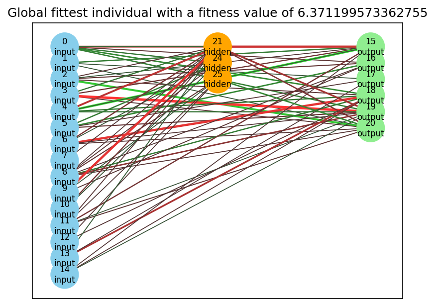
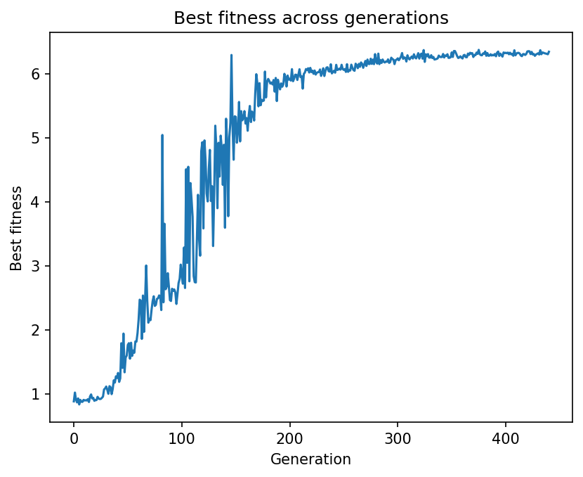
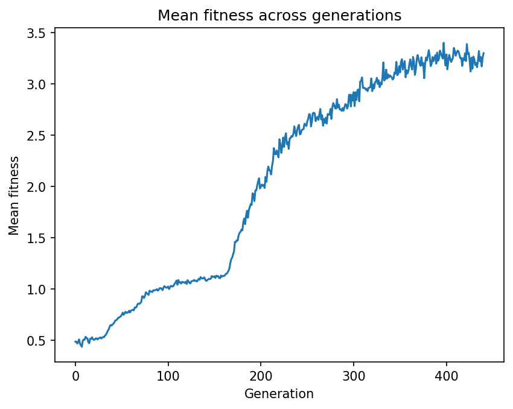

# Walking Creatures

 **Walking Creatures** is a neuroevolution project built in Python 3.12 that trains simulated creatures to walk using the PyBullet physics engine. The project implements a custom genetic algorithm heavily inspired by **NEAT** (NeuroEvolution of Augmenting Topologies) to evolve neural networks that control the physical joints of predefined creature models.

## Table of Contents
- [About the Project](#about-the-project)
- [Key Features](#key-features)
- [Models Evaluated](#models-evaluated)
- [Results: Bipedal Model](#results-bipedal-model)
- [Installation & Usage](#installation--usage)
- [Authors](#authors)

---

## About the Project
The primary objective of this project is to evolve a neural network capable of achieving a stable, natural, and fast forward gait. The fitness of each creature is evaluated based on the distance traveled and its ability to avoid falling during a standard 10-second simulation window. 

The underlying algorithm relies on a custom NEAT implementation that features dynamic neural network topologies, allowing the creatures' "brains" to grow in complexity over time.

## Key Features
* **Custom Neuroevolution Engine**: A from-scratch genetic algorithm supporting speciation to protect structural innovations (calculated via disjoint/excess genes and weight differences).
* **Advanced Genetic Operators**: 
  * Crossover of homologous genes.
  * Mutations including weight adjustments, the addition of new connections, and the insertion of hidden nodes.
* **Physics Integration**: Real-time physical environment simulation powered by `pybullet`.
* **Configurable Environments**: 
  * Multiple fitness functions (e.g., `XDistanceFitness`, `AbsXDistanceStabilityFitness`).
  * Dynamic run conditions (time limit, fall detection).

## Models Evaluated
The algorithm was tested on different creature morphologies:
1. **Biped**: A two-legged model featuring 6 joints, each with 1 Degree of Freedom (DOF).
2. **Spider Bot**: A multi-legged model featuring a mix of 4 1-DOF joints and 4 3-DOF joints.
3. **Single-Joint Model**: Composed of two spheres connected by a single 3-DOF joint. Despite its structural simplicity, it proved highly difficult to balance, ultimately yielding worse results than the bipedal model even after ~48 hours of training.
4. **Quadruped**: Features a spherical body and four limbs, each connected by a single 3-DOF joint. It successfully traveled over 1 meter, though its low torso height prevented the use of a stability-based fitness function.

---

## Results: Bipedal Model

The bipedal model successfully evolved a stable and natural walking pattern. Training was conducted with a population size of 2,000 individuals over 441 generations. The fittest individual managed to travel over 6 meters naturally without falling.

### Neural Network Structure of the Best Individual
*Red lines indicate negative weights, green lines indicate positive weights. Line thickness correlates with the absolute value of the weight.*



### Training Metrics
The graphs below illustrate the algorithm's steady optimization and learning progress over the generations.

**Best Fitness Across Generations**


**Mean Fitness Across Generations**


---

## Installation & Usage

```bash
# Clone the repository
git clone [https://github.com/MrWlobo/Walking-Creatures.git](https://github.com/MrWlobo/Walking-Creatures.git)
cd Walking-Creatures

# Install dependencies
uv sync
```

## Authors
- Kacper Dłubała
- Michał Dworniczak

